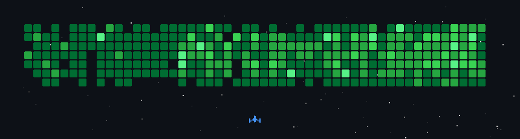
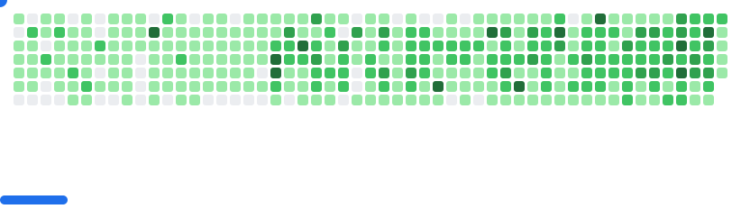

# Hi, I'm Gordon Beeming 👋

I build developer tools and write about .NET, Azure and AI-assisted development.

Father · Husband · Triathlete · [SSW Solution Architect](https://www.ssw.com.au/people/gordon-beeming/) 
[Microsoft MVP since 2014](https://mvp.microsoft.com/en-us/PublicProfile/5000879) · Brisbane, Australia.

[Website](https://gordonbeeming.com/) · [LinkedIn](https://www.linkedin.com/in/gordon-beeming/) · [YouTube](https://www.youtube.com/@gordonbeeming)

## Featured projects

<!-- FEATURED-PROJECTS:START -->
- [ClaudeBar](https://gordonbeeming.com/projects/claude-bar) — Your Claude usage limits in the macOS menu bar, in your timezone.
- [CodexBar](https://gordonbeeming.com/projects/codex-bar) — Your Codex usage limits in the macOS menu bar, in your timezone.
- [MyTerm](https://gordonbeeming.com/projects/myterm) — An opinionated native macOS terminal for people who keep several projects open all day.
<!-- FEATURED-PROJECTS:END -->

[All projects](https://gordonbeeming.com/projects)

## Latest posts

<!-- BLOG-POSTS:START -->
- [This Week in Developer Tech · W03](https://gordonbeeming.com/blog/2026-10-22/this-week-in-developer-tech-w03)
- [This Week in Developer Tech · W02](https://gordonbeeming.com/blog/2026-10-15/this-week-in-developer-tech-w02)
- [Getting mouse clicks working in Claude Code](https://gordonbeeming.com/blog/2026-10-09/claude-code-mouse-clicks-need-the-fullscreen-renderer)
<!-- BLOG-POSTS:END -->

[More writing](https://gordonbeeming.com/blog)

If one of my tools helped you, [you can buy me a coffee](https://www.buymeacoffee.com/gordonbeeming).

## GitHub activity

<a href='https://github.com/gordonbeeming'>
  <picture>
    <source media="(prefers-color-scheme: light)" srcset="https://raw.githubusercontent.com/GordonBeeming/GordonBeeming/refs/heads/gb/chore/profile-cards/stats-light.svg">
    
  </picture>
</a>

<a href='https://github.com/gordonbeeming'>
  <picture>
    <source media="(prefers-color-scheme: light)" srcset="https://raw.githubusercontent.com/GordonBeeming/GordonBeeming/refs/heads/gb/chore/profile-cards/top-langs-light.svg">
    
  </picture>
</a>

## A little fun

Thanks [@czl9707](https://github.com/czl9707) for [gh-space-shooter](https://github.com/czl9707/gh-space-shooter) above

<picture>
  <source
    media="(prefers-color-scheme: dark)"
    srcset="images/breakout-dark.svg"
  />
  <source
    media="(prefers-color-scheme: light)"
    srcset="images/breakout-light.svg"
  />
  
</picture>

Thanks [@cyprieng](https://github.com/cyprieng) for [github-breakout](https://github.com/cyprieng/github-breakout) above
